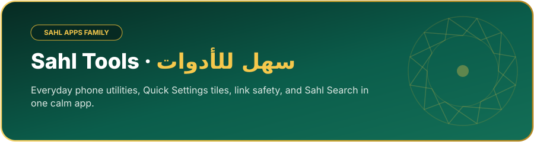

  

---

## ✨ Highlights

| Feature | What it gives you |
|---|---|
| 🎛️ **Quick Settings Tiles** | Keep Screen On, Volume Lock, Touch Lock, Floating Timer, Screen Dimmer, Torch, and Sound Mode. |
| 🛡️ **Link Safety & Call Guard** | Checks tapped links before opening and blocks unwanted spam calls silently. |
| 🔍 **Sahl Universal Search** | Search across Sahl Contacts, Phone, Messages, and Files from one place. |
| 📶 **Network & App Tools** | Built-in speed test, data usage tracker, QR scanner, Wi-Fi sharing, and focus tools. |

---

## 📲 Install in Seconds

1. Tap **[Download Latest APK](https://github.com/AliSherif1309/SahlTools/releases/latest)** above.
2. Open the downloaded `.apk` file on your Android phone to install.
3. **Sahl Tools** checks for new versions automatically so you stay up to date in one tap.

---

## 🌿 The Sahl Apps Family · عائلة تطبيقات سهل

A calm, ad-free, bilingual (**Arabic & English**) suite of everyday Android apps crafted in **Emerald & Gold**:

[🎨 Sahl Theme](https://github.com/AliSherif1309/SahlHome) · [🕌 Sahl Adhan](https://github.com/AliSherif1309/SahlAdhan) · [🧭 Sahl Qibla](https://github.com/AliSherif1309/SahlQibla) · [📞 Sahl Phone](https://github.com/AliSherif1309/SahlPhone) · [👤 Sahl Contacts](https://github.com/AliSherif1309/SahlContacts) · [💬 Sahl Messages](https://github.com/AliSherif1309/SahlMessages) · [📷 Sahl Camera](https://github.com/AliSherif1309/SahlCamera) · [🖼️ Sahl Gallery](https://github.com/AliSherif1309/SahlGallery) · [📁 Sahl Files](https://github.com/AliSherif1309/SahlFiles) · [📄 Sahl PDF](https://github.com/AliSherif1309/SahlPDF) · [☁️ Sahl Sync](https://github.com/AliSherif1309/SahlSync) · [📺 Sahl TV](https://github.com/AliSherif1309/SahlTV-Launcher)
